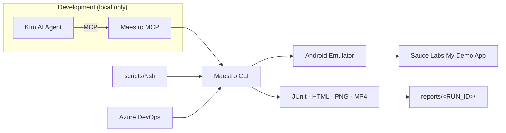

# Maestro Mobile Automation Framework

A lightweight, scalable, **Maestro-native** mobile test automation framework and
working Proof of Concept. It automates the **Sauce Labs My Demo App**
(`com.saucelabs.mydemoapp.android`) on a local Android emulator, assisted by
**Kiro AI + Maestro MCP**, and produces HTML/JUnit reports, screenshots and MP4
video evidence suitable for a technical review and a business demo.

> Status: POC passing. 8/8 flows green on the verified environment. See
> [Implementation status](#implementation-status).

## Overview

The goal is to prove that AI-assisted, Maestro-native automation is a fast,
maintainable way to cover real mobile user journeys — without the weight of a
traditional Appium stack. Kiro uses the Maestro MCP server to inspect live
screens and author tests; the resulting YAML flows then run on their own from the
terminal and in CI (no AI agent required at execution time).

**Business value:** readable tests, quick authoring, evidence (reports + screenshots
+ video) on every run, and a clear path to CI/CD.

## Technology Stack

| Component | Responsibility |
|---|---|
| **Maestro** (CLI 2.12.0) | Declarative YAML flow engine; drives the device, asserts UI, produces reports/screenshots/video. |
| **Maestro MCP** | Exposes Maestro to Kiro (`list_devices`, `inspect_screen`, `run`, …) for AI-assisted development/debugging. Dev-only. |
| **Kiro** | AI agent that inspects screens, writes/validates flows, runs the suite, and generates evidence. |
| **Android Studio** | Provides the Android SDK, emulator and `adb`. |
| **Android emulator** | The device under test (`emulator-5554`, AVD `Pixel_10_Pro`, Android 17). |
| **Azure DevOps** | Intended CI/CD host (template provided; needs an emulator-capable agent). |

## Architecture



More detail (composition + decisions): [`docs/architecture.md`](docs/architecture.md).

## Why Maestro (not Appium)?

| Aspect | Maestro-native (this framework) | Traditional Appium |
|---|---|---|
| Test format | Readable YAML flows | Code (Java/TS) + Page Objects |
| Setup | Single CLI, no server | Appium server + drivers + WebDriver |
| Composition | Native `runFlow` subflows | Custom base classes / helpers |
| Waiting | Implicit, built-in | Manual explicit waits |
| AI integration | First-class via MCP | None standard |
| Evidence | Screenshots, video, HTML/JUnit built-in | Assembled from plugins |
| Maintenance | Low — ids + subflows | Higher — code + abstractions |

Chosen for readability, maintainability, a lightweight footprint, native flow
composition, AI integration and built-in reporting. (No performance claims made.)

## Framework Structure

```
.
├── .kiro/
│   ├── settings/mcp.json          # Maestro MCP server config (do not overwrite)
│   └── steering/                  # Standards for working in this repo
├── .maestro/
│   ├── config.yaml                # Workspace config (run: maestro test .maestro)
│   └── flows/
│       ├── smoke/TC001-launch-app.yaml
│       ├── regression/
│       │   ├── authentication/TC002-valid-login.yaml, TC003-invalid-login.yaml
│       │   ├── products/TC004-product-details.yaml
│       │   ├── cart/TC005-add-to-cart.yaml, TC006-remove-from-cart.yaml
│       │   └── checkout/TC007-checkout.yaml
│       └── navigation/TC008-navigation.yaml
├── subflows/                      # Reusable runFlow targets (NOT standalone tests)
│   ├── authentication/login.yaml
│   ├── cart/add-product.yaml
│   └── navigation/open-menu.yaml, reset-state.yaml
├── environments/                  # .env.example + per-env config (real ones git-ignored)
├── scripts/                       # check-environment, run-smoke/-regression/-with-evidence, summary
├── reports/                       # Generated evidence per run (git-ignored)
├── docs/                          # Architecture, discovery, setup, strategy, reporting, mcp, demo
├── azure-pipelines.yml            # CI template (unvalidated; needs emulator agent)
└── README.md
```

## Prerequisites

| Tool | Version verified |
|---|---|
| Java JDK | 17 |
| Maestro CLI | 2.12.0 |
| Android SDK + `adb` | platform-tools 1.0.41 |
| Android emulator | API 31+ (API 37 verified) |
| Sauce Labs My Demo App | 2.3.0 (`com.saucelabs.mydemoapp.android`) |

## Quick Start

```bash
# 1. Clone
git clone <repo-url> && cd Maestro-Mobile-Automation-Framework

# 2. Configure local env (defaults use the app's synthetic demo credentials)
cp environments/.env.example environments/.env.poc

# 3. Start the Android emulator (Android Studio → Device Manager), then:
export PATH="$HOME/Library/Android/sdk/platform-tools:$PATH"

# 4. Verify ADB connectivity + app install
adb devices -l
adb shell pm list packages | grep saucelabs

# 5. Check the environment
./scripts/check-environment.sh

# 6. Run your first test
maestro test .maestro/flows/smoke/TC001-launch-app.yaml

# 7. Smoke suite
./scripts/run-smoke.sh

# 8. Regression suite
./scripts/run-regression.sh

# 9. Full evidence bundle (reports + screenshots + videos + summary)
./scripts/run-with-evidence.sh all

# 10. View evidence
open reports/<RUN_ID>/html/report.html
open reports/<RUN_ID>/execution-summary.md
open reports/<RUN_ID>/videos/
```

> **Key gotcha:** run `maestro test .maestro` (the workspace dir), **not**
> `.maestro/flows`. Maestro reads `config.yaml` from the dir you pass and uses
> its inclusion patterns to discover flows recursively.

## Working with Kiro and MCP

Kiro connects to Maestro via `.kiro/settings/mcp.json`. The development loop is
`list_devices → inspect_screen → run`, saving verified flows into `.maestro/flows`.
Full guide: [`docs/mcp-guide.md`](docs/mcp-guide.md). MCP is used only for
authoring/debugging — committed tests run via the CLI with no agent.

## Writing New Tests

```yaml
# .maestro/flows/regression/products/TCxxx-example.yaml
appId: com.saucelabs.mydemoapp.android
name: "TCxxx - Example"
tags: [regression, products]
---
- launchApp:
    clearState: true
- assertVisible:
    id: "com.saucelabs.mydemoapp.android:id/productTV"
    text: "Products"
- takeScreenshot: "TCxxx-products"
```

Use real selectors from [`docs/application-discovery.md`](docs/application-discovery.md).

## Creating Reusable Flows

```yaml
# Compose with native runFlow; pass data via env.
- runFlow:
    file: "../../../../subflows/authentication/login.yaml"
    env:
      USERNAME: ${TEST_USERNAME}
      PASSWORD: ${TEST_PASSWORD}
```

The relative path depends on the caller's depth. From
`.maestro/flows/regression/<feature>/` it is `../../../../subflows/...`; from
`.maestro/flows/<suite>/` it is `../../../subflows/...`. Both are used and verified
in this repo.

## Test Tags

| Tag | Meaning |
|---|---|
| `smoke` | Minimal health check (TC001). |
| `regression` | Full journey coverage (TC002–TC008). |
| `authentication`, `products`, `cart`, `checkout`, `navigation` | Feature areas. |
| `negative`, `e2e` | Negative path / end-to-end. |

```bash
maestro test --include-tags smoke .maestro
maestro test --include-tags cart .maestro
maestro test --include-tags regression --exclude-tags e2e .maestro
```

## Environment Configuration

Per-environment files in `environments/` (`.env.poc`, `.env.sit`, `.env.uat`);
only `.env.example` is tracked. Select with `TARGET_ENV`:

```bash
TARGET_ENV=SIT ./scripts/run-regression.sh
```

See [`environments/README.md`](environments/README.md).

## Reports and Evidence

```
reports/<RUN_ID>/
├── junit/report.xml            # machine-readable results
├── html/report.html           # HTML-DETAILED report
├── screenshots/*.png           # key verification points
├── videos/*.mp4                # playable journey recordings
├── debug/raw/.../              # commands.json, manifest.json, logs/
└── execution-summary.md        # business summary (from actual results)
```

Details: [`docs/reporting-guide.md`](docs/reporting-guide.md).

## Troubleshooting

| Problem | Fix |
|---|---|
| "Top-level directories do not contain any Flows" | Run `maestro test .maestro`, not `.maestro/flows`. |
| Emulator not detected | Start an AVD; `adb devices` must list it as `device`. |
| `adb: command not found` | `export PATH="$HOME/Library/Android/sdk/platform-tools:$PATH"`. |
| App not installed | `adb install -r <app>.apk`; confirm with `pm list packages`. |
| MCP tools missing in Kiro | Reconnect via MCP Server view / reload window; verify `maestro mcp` starts. |
| Selector not found | Re-inspect with Maestro MCP `inspect_screen`; for repeated ids use `index:`. |
| Checkout field not found | Keyboard overlaps it — `hideKeyboard` + `scrollUntilVisible`. |
| Recording problems | Use `maestro record --local <flow> <out.mp4>`; keep journeys short. |
| Empty/missing reports | Ensure `--format` + `--output` are set; check `reports/<RUN_ID>/`. |

## CI/CD Integration

`azure-pipelines.yml` runs `maestro test .maestro`, publishes JUnit via
`PublishTestResults@2`, and uploads screenshots/recordings/logs as artifacts. It
is an **unvalidated template**: hosted agents generally can't run a hardware
emulator, so a self-hosted emulator agent or a cloud device farm is required. See
the file header and [`docs/architecture.md`](docs/architecture.md).

## Future Enhancements

- More journeys (sorting, quantity changes, multiple products, logout).
- Additional Android versions/devices; then iOS.
- Parallel and cloud device execution (Maestro Cloud).
- Dedicated test-data management for SIT/UAT accounts.
- Azure DevOps dashboards/trends from published results.
- Enterprise regression scaling (sharding across devices).

## Implementation status

| Area | Status |
|---|---|
| Maestro-native framework | ✅ Complete |
| App automated (My Demo App 2.3.0) | ✅ Complete |
| ≥ 5 meaningful passing scenarios | ✅ 8/8 pass |
| Logical organisation by feature | ✅ Complete |
| ≥ 2 reusable subflows | ✅ 4 subflows |
| Kiro + Maestro MCP used | ✅ Discovery + authoring |
| Terminal execution without AI | ✅ Scripts + CLI |
| HTML + JUnit reports | ✅ Complete |
| Screenshots for key scenarios | ✅ 14 screenshots |
| ≥ 1 playable MP4 | ✅ Verified MP4s |
| Business summary from real results | ✅ Complete |
| Documentation | ✅ Complete |
| Azure DevOps requirements | ✅ Documented (template unvalidated) |

## Documentation index

- [Application discovery](docs/application-discovery.md) — verified app map & selectors
- [Architecture](docs/architecture.md)
- [Setup guide](docs/setup-guide.md)
- [Test strategy](docs/test-strategy.md)
- [Reporting guide](docs/reporting-guide.md)
- [MCP guide](docs/mcp-guide.md)
- [Business demo guide](docs/business-demo-guide.md)
