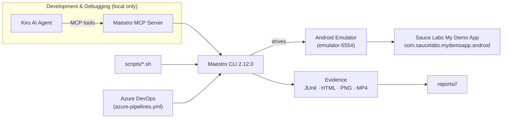
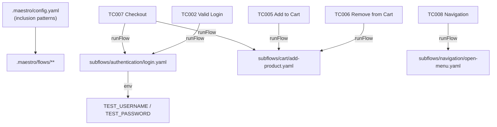

# Architecture

A lightweight, Maestro-native architecture. No Appium, WebDriver, Selenium, Page
Objects, or custom runner — just YAML flows, subflow composition, env config, and
the Maestro CLI.

## Runtime flow

## Composition model

## Key design decisions

| Decision | Why |
|---|---|
| YAML flows, no POM | Maestro's model; readable by any QA engineer, less code to maintain. |
| `runFlow` subflows | DRY for login / add-product / menu; one place to fix UI changes. |
| `env` for all data | No secrets in flows; same flows run across POC/SIT/UAT. |
| Run `maestro test .maestro` | Workspace `config.yaml` drives recursive discovery (verified requirement). |
| Subflows outside `.maestro/` | They are composition targets, never collected as standalone tests. |
| MCP only for dev/debug | CI runs the committed flows via the CLI with no agent dependency. |
| resource-id-first selectors | Stable across language/layout; see `application-discovery.md`. |

## Execution paths

- **Local dev:** Kiro + Maestro MCP to inspect screens and author/validate flows.
- **Local CLI:** `scripts/run-smoke.sh`, `run-regression.sh`, `run-with-evidence.sh`.
- **CI:** `azure-pipelines.yml` runs `maestro test .maestro` and publishes results
  (template; needs an emulator-capable agent).
